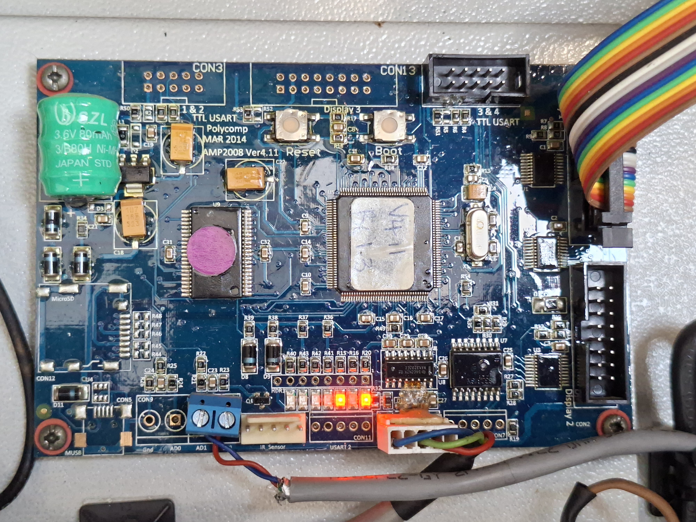

# polycomp-manager

Replacement controller software for **PolyComp AMP2008** LED text signs (192 × 32 pixels, red/green P10
modules). The vendor's software is long gone, so this project reverse-engineered the sign's serial
protocol from a 2008 web archive and the board's own firmware, and ships two ways to drive it:

- **A Windows desktop app** (`winapp/`), a single `.exe` with a point-and-click editor and live preview.
  Runs on Windows 7+ and under Wine.
- **A Python command-line tool** (`polycomp/`), handy for scripting and for poking at the protocol.



## Features

- Four small rows of 32 characters, or join row pairs into big 16-pixel rows.
- Red, green and yellow text, flashing, double-width characters, left/centre/right alignment.
- Display effects (appear, wipe, roll, fade, ...) and a marquee mode that scrolls the bottom row
  while the rows above stay static.
- Multi-page messages that cycle on the sign, with a configurable time per page.
- Pages are stored in the sign and survive power-off.
- Set the sign's clock from the PC.
- Messages saved as small `.json` files; the app restores the last message on start.
- Every send path has a dry-run / hex-dump mode, and the app has a log pane showing raw bytes.

## Quick start (Windows app)

1. Unplug the sign's internal GSM modem (if fitted) and connect the board's serial cable to a
   USB-to-RS232 adapter through a **DB9 female-to-female null modem cable**.
2. Download or build `PolycompManager.exe` (see below), run it, and pick the adapter's COM port.
3. Choose a layout, type your rows, check the preview, press **Send to sign**. The status line
   confirms the sign's acknowledgement.

The same executable works from a command prompt:

```
PolycompManager.exe --send examples\sample-menu.json --port COM3
PolycompManager.exe --set-clock --port COM3
PolycompManager.exe --send message.json --dry-run
```

## Quick start (Python CLI)

Needs Python 3 and [pyserial](https://pypi.org/project/pyserial/). No other dependencies.

```
python3 -m polycomp.cli send --tall top --centre 'Coffee Shop\n{G}Coffee R25'
python3 -m polycomp.cli send --tall top --centre --effect SLIDE --tempo 3 'HEADING\n\n{Y}{E}scrolling text'
python3 -m polycomp.cli send --dry-run "HELLO"          # print the frame as hex, no port needed
python3 -m polycomp.cli listen --seconds 10            # dump anything the sign transmits
```

Rows are separated with `\n`. Inline markup: `{R}` `{G}` `{Y}` colour, `{F}` flash, `{E}` wide,
`{D}` back to default. `--tall top|bottom|both` joins row pairs into big rows,
`--align left|centre|right` positions each row.

Run the tests with `python3 run_tests.py` (or `pytest` if installed).

## Building the Windows app

The app is written in Go and cross-compiles from Linux or macOS with no Windows machine involved:

```
cd winapp
./build.sh        # produces dist/PolycompManager.exe (64-bit) and dist/PolycompManager-32bit.exe
go test ./...
```

See [`winapp/README.md`](winapp/README.md) for usage details and for testing under Wine.

## Hardware notes

| Item | Detail |
|---|---|
| Sign | PolyComp `RGT32/P10-4L 192x32`, two colours (red + green, yellow by mixing) |
| Controller | PolyComp **AMP2008 Ver 4.11**, STM32F103 MCU, DS3231 clock, MAX3232 RS232 port |
| Serial | 9600 baud, 8 data bits, no parity, 1 stop bit, header marked `USART1` |
| Cable | Board cable ends in a male DB9 wired as DTE; use a null modem cable to a PC adapter |
| Adapter | Any USB-to-RS232 adapter; an FTDI FT232R was used for development |

The board's self-test screen shows the configured baud rate at power-up. If the sign has an internal
GSM modem, its serial cable goes to the modem's port and nothing you send reaches the board until
the modem is unplugged.

## How the protocol was worked out

The only public documentation is a 2008 copy of PolyComp's GTXC protocol page, linked from
[`docs/`](docs/). It got the frame format right but was silent or wrong on several points that
this firmware cares about, so the STM32's factory bootloader was used to read the firmware out
(read-only) and the serial receive state machine was disassembled. The findings that matter:

- Never set the "interrupt mode" bit in the status byte; this firmware silently drops such frames.
- The `Nol` byte must be 0 or the sign's configured line count.
- Text is a plain stream that fills rows of 32 characters in order. Line breaks are made by
  padding, not by CR or LF. A joined (big) row pair consumes 64 characters and shows the first 16.
- The vendor's example page-status value floods the board green; use `0x80`.
- There is an undocumented short message form and a raw bitmap upload path.

Everything learned is recorded in [`CLAUDE.md`](CLAUDE.md), which doubles as the project's
engineering log, and the diagnostic scripts used along the way live in [`tools/`](tools/).

## Repository layout

```
polycomp/      Python package: protocol.py (frames), layout.py (rows), link.py (serial), cli.py
tests/         Python tests, including the vendor's reference frame byte for byte
winapp/        Go source for the Windows app (GUI, serial backend, protocol port, tests)
examples/      Ready-made message files
tools/         Protocol probes, firmware disassembly helper, STM32 bootloader reader
docs/          Link to the 2008 protocol page
images/        Photos of the controller board
```

## Status

Works end to end against a real sign: every verified frame, layout rule and effect is listed in
`CLAUDE.md`. The Windows app has been exercised under Wine and not yet on a native Windows
machine. Open items include deleting stored pages, the raw bitmap path, and the second board.

## Disclaimer

This is an independent project. It is not affiliated with, endorsed by or supported by
PolyComp (Pty) Ltd. PolyComp is the trademark of its owner. Use at your own risk.

## Licence

[MIT](LICENSE).
